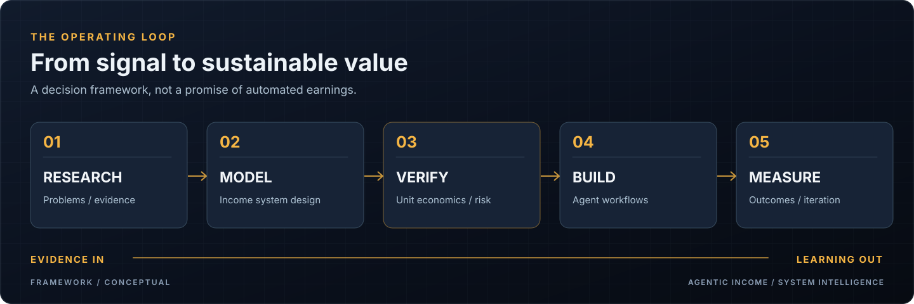
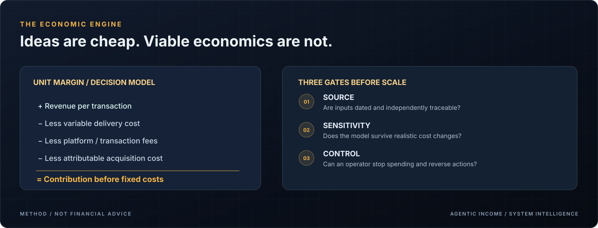
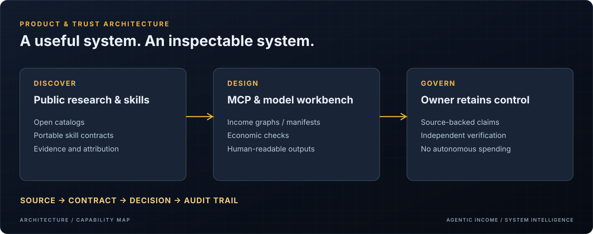
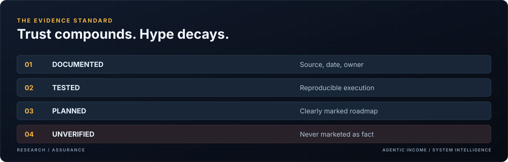

<div align="center">


# Agentic Income

**An open ecosystem for designing, evaluating, and building agent-powered income systems.**

Research the opportunity. Model the economics. Build with agents. Keep control.

[**Explore the platform**](https://www.agenticincome.ai/) · [**Connect the MCP**](https://www.agenticincome.ai/mcp) · [**Install the skill**](https://github.com/Agentic-Income/agentic-income-skills) · [**Browse open research**](https://github.com/Agentic-Income/awesome-agentic-income)

</div>

---

## The thesis

**An agent can produce an artifact. An economic system must produce value that survives scrutiny.**

Agentic Income treats income opportunities as systems with explicit inputs, delivery costs, contracts, attribution, risks, and human decision rights. Open tools help builders reason about what is viable before committing time or capital.



> **A decision framework, not an earnings promise.** The illustration depicts the operating philosophy; it does not claim that every stage is autonomously implemented or revenue-generating.

## The decision advantage

The essential question is not *"Can AI build it?"* It is **"Can this produce durable value after costs, risks, and distribution are accounted for?"**



We distinguish an attractive narrative from an investable model. Costs, terms, and assumptions are dated and traceable when supported by sources. Hypotheses stay hypotheses.

## Choose your entry point

| You are building… | Start here | Outcome |
| :--- | :--- | :--- |
| **An agent or automated workflow** | [MCP server](https://www.agenticincome.ai/mcp) + [agentic-income-skills](https://github.com/Agentic-Income/agentic-income-skills) | Structured income-system models, skills, and inspectable outputs |
| **A product or distribution business** | [Agentic Income template](https://github.com/Agentic-Income/agentic-income-template) | A Next.js + MDX starting point for publishing research and comparisons |
| **A research or operator practice** | [Awesome Agentic Income](https://github.com/Agentic-Income/awesome-agentic-income) | Curated resources for delivery, metering, billing, attribution, and governance |
| **An affiliate operation** | [Affiliate agent skills](https://github.com/Agentic-Income/affiliate-agent-skills) | Workflows for catalog audits, disclosure, and evidence-backed recommendations |
| **An investment research workflow** | [GenInvestor](https://github.com/Agentic-Income/GenInvestor) + [investor skills](https://github.com/Agentic-Income/awesome-investor-agent-skills) | Research workflows, evidence ledgers, and claims review |

## Built for agents. Accountable to people.



### Connect over MCP

The platform documents a streamable-HTTP Model Context Protocol endpoint:

```text
https://www.agenticincome.ai/api/mcp
```

[Endpoint documentation](https://www.agenticincome.ai/mcp) · [Discovery manifest](https://www.agenticincome.ai/.well-known/mcp.json)

Example Claude Code configuration, subject to your installed CLI version and live endpoint availability:

```sh
claude mcp add --transport http agentic-income https://www.agenticincome.ai/api/mcp
```

The repository's documented MCP surface covers income-graph drafting and review, income-system manifests, business-model fit checks and playbooks, partner-program research, and catalog availability. **Tool availability can vary by deployed version.** Inspect the live discovery endpoint before relying on a named tool. In the prior documented deployment snapshot, some Economy Vault tools were in source but not yet promoted; we do not represent those as live here.

### Install the portable skill

```sh
npx skills add frankxai/agentic-income-skills --skill agentic-income
```

The canonical source for this skill is [`frankxai/agentic-income-skills`](https://github.com/frankxai/agentic-income-skills); the [organization repository](https://github.com/Agentic-Income/agentic-income-skills) is a federated public mirror. Inspect the instructions and run the included tests before production adoption.

## Evidence is the product



**No fabricated returns. No implied checkout availability. No undisclosed affiliate economics.** We separate sourced facts, reproducible tests, future roadmap, and unsupported claims. Partner-program terms and cost inputs must carry source and date; revenue outcomes are not assumed.

### Open-source collection

| System | Public repository |
| :--- | :--- |
| Portable agent skills and reference contracts | [agentic-income-skills](https://github.com/Agentic-Income/agentic-income-skills) |
| Business and infrastructure research catalog | [awesome-agentic-income](https://github.com/Agentic-Income/awesome-agentic-income) |
| Publishing and comparison starter | [agentic-income-template](https://github.com/Agentic-Income/agentic-income-template) |
| Affiliate research and compliance skills | [affiliate-agent-skills](https://github.com/Agentic-Income/affiliate-agent-skills) |
| Investor research and evidence ledger | [GenInvestor](https://github.com/Agentic-Income/GenInvestor) |
| Investor and wealth skills catalogs | [investor skills](https://github.com/Agentic-Income/awesome-investor-agent-skills) · [wealth skills](https://github.com/Agentic-Income/awesome-wealth-agent-skills) |

For the complete repository roster, transfer-versus-mirror ownership, archived repositories and operational guardrails, read the [organization operating contract](https://github.com/Agentic-Income/.github/blob/main/AGENTS.md). Do not treat mirrors as canonical sources.

## Participate in the open economy

Contributions should make an actual decision easier: a reproducible workflow, better unit economics, a new verifiable source, a safer skill, or a clearer explanation. Start with [contribution guidelines](https://github.com/Agentic-Income/.github/blob/main/CONTRIBUTING.md) and [security policy](https://github.com/Agentic-Income/.github/blob/main/SECURITY.md).

---

<div align="center">

**Build value. Show your work. Keep the keys.**

[AgenticIncome.ai](https://www.agenticincome.ai/) · [Organization governance](https://github.com/Agentic-Income/.github/blob/main/AGENTS.md) · [GitHub](https://github.com/Agentic-Income)

<sub>Agentic Income · An owner-controlled, evidence-led open ecosystem · Maintained by <a href="https://github.com/frankxai">Frank Riemer</a></sub>

</div>
