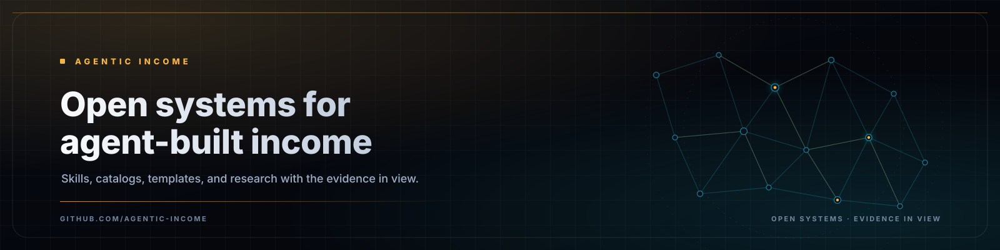

# Agentic Income

Open systems for agent-built income — skills, catalogs, templates, and research with the evidence in view.



## Start here

| If you are | Start with | What you get |
| :--- | :--- | :--- |
| An agent or skill author | [agentic-income-skills](https://github.com/Agentic-Income/agentic-income-skills) | Portable skills and open contracts for principal-owned agent work. |
| An operator or publisher | [awesome-agentic-income](https://github.com/Agentic-Income/awesome-agentic-income) | A catalog of delivery, metering, billing, attribution, and governance resources. |
| A builder | [agentic-income-template](https://github.com/Agentic-Income/agentic-income-template) | A clone-and-deploy Next.js 16 + MDX starter for an honest comparison site. |

## For agents

Install the `agentic-income` skill into a project, then run the reference validation locally:

```sh
npx skills add frankxai/agentic-income-skills --skill agentic-income

git clone https://github.com/Agentic-Income/agentic-income-skills.git
cd agentic-income-skills && npm install && npm test
```

The install resolves from the source repository (`frankxai/agentic-income-skills`); this organisation carries the public mirror.

## Repository map

Ten active repositories, each with one job. Four were transferred here and are sourced here; five are federated mirrors of `frankxai`. See [`AGENTS.md`](https://github.com/Agentic-Income/.github/blob/main/AGENTS.md) for the full roster.

| Repository | Purpose | Visibility |
| :--- | :--- | :--- |
| [`agentic-income-skills`](https://github.com/Agentic-Income/agentic-income-skills) | Portable skills and open contracts for principal-owned agent services. | Public |
| [`awesome-agentic-income`](https://github.com/Agentic-Income/awesome-agentic-income) | Catalog of agent-product delivery, metering, billing, attribution, and governance resources. | Public |
| [`agentic-income-template`](https://github.com/Agentic-Income/agentic-income-template) | Next.js 16 + MDX starter for an honest AI-tool comparison site. | Public |
| [`affiliate-agent-skills`](https://github.com/Agentic-Income/affiliate-agent-skills) | Skill pack for affiliate catalog audits, disclosure, and revenue loops. | Public |
| [`awesome-investor-agent-skills`](https://github.com/Agentic-Income/awesome-investor-agent-skills) | Catalog of research-only investor analysis skills. | Public |
| [`awesome-wealth-agent-skills`](https://github.com/Agentic-Income/awesome-wealth-agent-skills) | Wealth-research skills for reporting and scenarios. | Public |
| [`GenInvestor`](https://github.com/Agentic-Income/GenInvestor) | Local-first investor research workspace with an evidence ledger and claims audit. | Public |
| `.github` | Organisation profile, governance contracts, templates, and reusable CI. | Public |
| `agenticincome` | Next.js hub site teaching agentic income systems. | Private |
| `agenticpassiveincome` | AI-tool affiliate comparison site with recurring-payer monetisation. | Private |

<details>
<summary>Archived repositories (4)</summary>

Retired under the `20261018` naming pass and kept read-only. New work belongs in the active repository with the same base name.

| Archived repository | Superseded by |
| :--- | :--- |
| `agentic-income-template-retired-20261018` | `agentic-income-template` |
| `awesome-agentic-income-retired-20261018` | `awesome-agentic-income` |
| `awesome-investor-agent-skills-retired-20261018` | `awesome-investor-agent-skills` |
| `awesome-wealth-agent-skills-retired-20261018` | `awesome-wealth-agent-skills` |

</details>

## Standards

- **Draft-first pull requests.** Open a draft, verify locally, then mark it ready once.
- **Maker is not the checker.** The harness or person that writes a change does not approve it.
- **No secrets.** Credentials stay in local environment files or the secret manager; committed keys and `.env` files are rejected.
- **Evidence over claims.** Public copy names its source, date, and limits; unverified numbers are left out.

---

<sub>Maintained by <a href="https://github.com/frankxai">Frank Riemer</a> · Built on the <a href="https://github.com/Starlight-Intelligence-Systems/Starlight-Intelligence-System">Starlight Intelligence Protocol (SIP)</a></sub>
