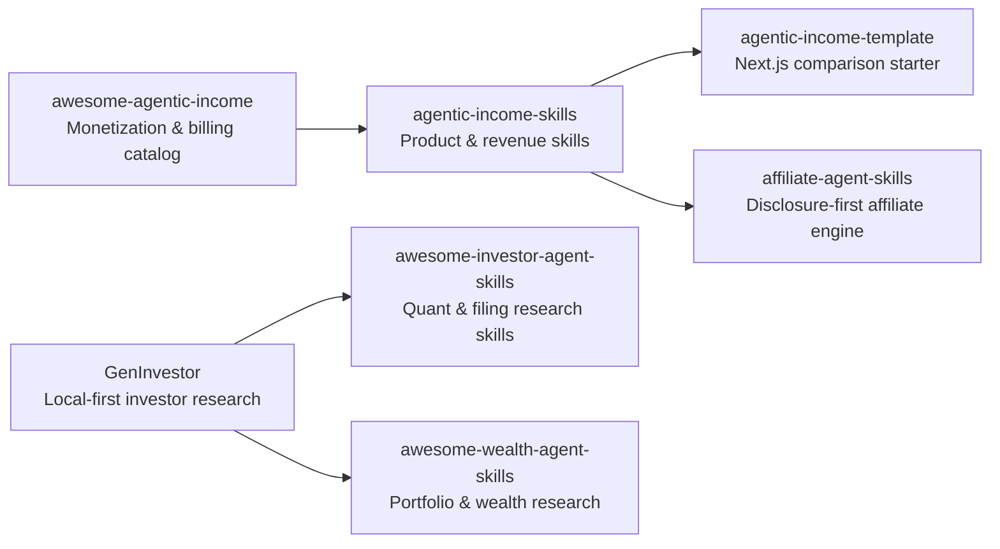

# Agentic Income

Open skills, templates, and research catalogs for agent-built digital products, wealth research, and creator revenue.

**Website:** [agenticincome.ai](https://agenticincome.ai) · **Ecosystem:** [Starlight Intelligence](https://github.com/Starlight-Intelligence) · [Starlight Systems](https://github.com/Starlight-Intelligence-Systems) · [Arcanea Labs](https://github.com/Arcanea-Labs) · [GenCreator](https://github.com/GenCreator-ai) · [FrankX](https://github.com/FrankX-AI)

---

## Overview

Agentic Income builds open-source templates, research skills, and transparent catalogs for digital product monetization, affiliate disclosure compliance, and local-first investor research.

## System topology



## Flagship repositories

| Repository | Purpose | Link |
| :--- | :--- | :--- |
| [**GenInvestor**](https://github.com/Agentic-Income/GenInvestor) | Open-source, local-first investor research workspace with filing provenance and thesis tracking. | [Website](https://agenticincome.ai) |
| [**awesome-agentic-income**](https://github.com/Agentic-Income/awesome-agentic-income) | Catalog of agent-product billing, metered APIs, storefront templates, and unit economics. | [Website](https://agenticincome.ai) |
| [**agentic-income-skills**](https://github.com/Agentic-Income/agentic-income-skills) | Portable agent skills for building transparent AI tool directories and digital product funnels. | [Website](https://agenticincome.ai) |
| [**agentic-income-template**](https://github.com/Agentic-Income/agentic-income-template) | Clone-and-deploy starter for transparent AI tool comparison and review sites. | [Website](https://agenticincome.ai) |
| [**affiliate-agent-skills**](https://github.com/Agentic-Income/affiliate-agent-skills) | Agent skill pack for affiliate catalog auditing, link verification, and FTC disclosure compliance. | [Website](https://agenticincome.ai) |
| [**awesome-investor-agent-skills**](https://github.com/Agentic-Income/awesome-investor-agent-skills) | Curated index of research-only equity, filing, and quantitative analysis skills for coding agents. | [Website](https://agenticincome.ai) |
| [**awesome-wealth-agent-skills**](https://github.com/Agentic-Income/awesome-wealth-agent-skills) | Research and reporting skill catalog for personal balance-sheet modeling and scenario analysis. | [Website](https://agenticincome.ai) |

## Quickstart

```bash
# Clone the local-first GenInvestor research toolkit
git clone https://github.com/Agentic-Income/GenInvestor.git

# Clone the Agentic Income starter template
git clone https://github.com/Agentic-Income/agentic-income-template.git
```

## Engineering standards

Every repository in **Agentic Income** follows the Starlight estate engineering contract:

1. **Draft-first pull requests**: Open pull requests in draft mode (`gh pr create --draft`). CI workflows run only when a pull request is marked ready for review or lands on `main`.
2. **Independent verification**: Maker harness and Checker harness must differ (`Maker-Harness` != `Checker-Harness`).
3. **Zero committed secrets**: Credentials live in local environment files or Infisical. Pre-commit and CI gates reject secret patterns.
4. **Editorial clarity**: Public documentation uses sentence case headings, concrete verbs, and verified metrics.

---

<sub>Maintained by <a href="https://github.com/frankxai">Frank Riemer (frankxai)</a> · Built on the <a href="https://github.com/Starlight-Intelligence-Systems/Starlight-Intelligence-System">Starlight Intelligence Protocol (SIP)</a></sub>
